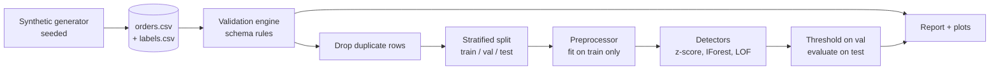
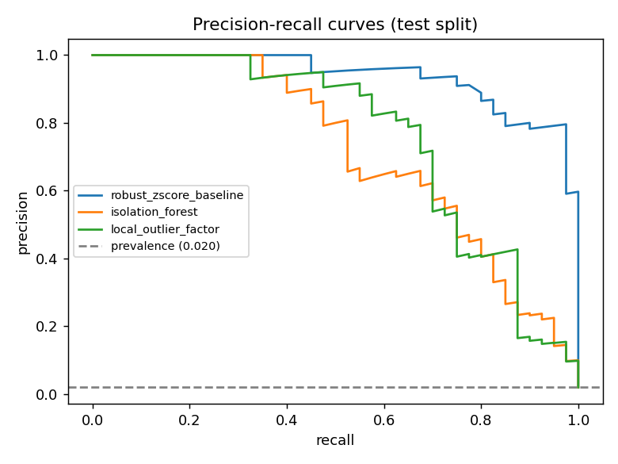
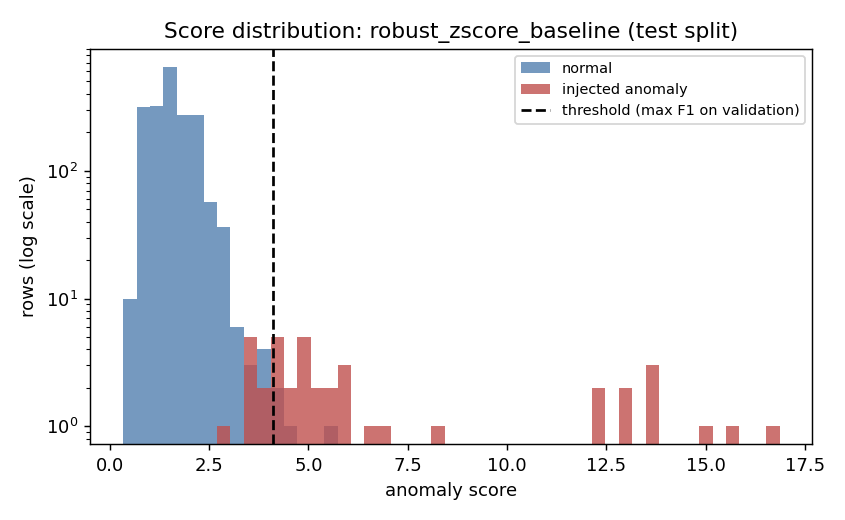
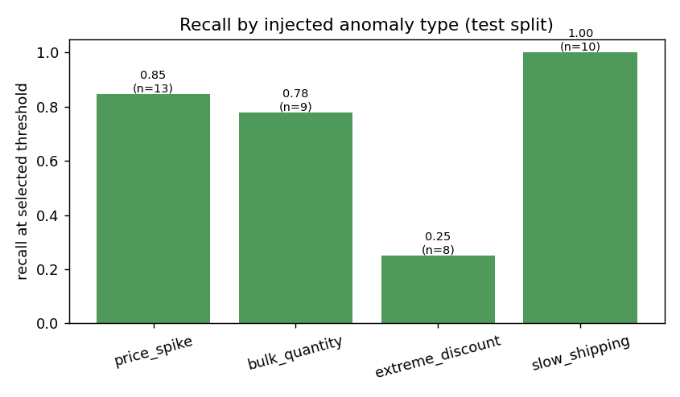

# AutoDataGuard

Automated data quality validation and anomaly detection for tabular order data.

## Business problem

Analytics teams lose time and trust when bad records reach dashboards and models. AutoDataGuard
separates two problems that are often confused:

1. **Rule violations**: records that are *invalid* (missing, wrong type, out of range, duplicated, inconsistent).
2. **Statistical anomalies**: records that are *valid but unusual* (e.g. a book priced 8x its category norm).

Measurable objectives (evaluated on the synthetic data against known injected ground truth):

- The rule engine should catch every injected rule violation with no false alarms.
- Anomaly detectors should beat the 2% prevalence baseline on PR-AUC and be compared against a simple statistical baseline.
- Thresholds are chosen on a validation split and reported on a held-out test split.

## Key features

- Schema-driven validation (completeness, validity, uniqueness, consistency) with per-dimension scores
- Synthetic order generator with a fixed seed and **separate** ground-truth labels
- Leakage-safe preprocessing (all statistics learned from the training split only)
- Three detectors: robust z-score baseline, Isolation Forest, Local Outlier Factor
- Threshold selection (max F1, or false-positive-rate budget) on validation data
- Per-anomaly-type recall and false-positive analysis
- Report, metrics JSON, data dictionary and plots generated from actual results

## Architecture



```
autodata-guard/
├── configs/default.json
├── src/autodataguard/
│   ├── config.py, pipeline.py, cli.py
│   ├── data/          schema.py, generator.py, validation.py, io.py
│   ├── features/      preprocessing.py
│   ├── models/        detectors.py
│   ├── evaluation/    metrics.py, splits.py, error_analysis.py
│   └── reporting/     plots.py, report.py, dictionary.py
├── tests/             43 unit and edge-case tests
├── reports/           report.md, metrics.json, data_dictionary.md  (generated, committed as example)
├── visualizations/    PNG plots                                     (generated, committed as example)
├── data/synthetic/    generated CSVs (git-ignored)
├── requirements.txt, pyproject.toml, LICENSE, .gitignore
```

## Technology stack

Python, NumPy, pandas, scikit-learn, Matplotlib. Tests use the standard `unittest` module (also
discovered by `pytest`). No external APIs or LLMs are needed.

## Dataset

Synthetic e-commerce orders (10,000 base rows, seed 42) with 11 columns. See
[`reports/data_dictionary.md`](reports/data_dictionary.md). Injected into the base data:

| Injection | Share | Purpose |
|---|---|---|
| Statistical anomalies (price spike, bulk quantity, extreme discount, slow shipping) | 2% | detector ground truth; totals stay consistent and values stay inside valid ranges |
| Rule violations (7 types) | 6% | validation ground truth |
| Exact duplicate rows appended at the end | 1% | uniqueness rule |

Labels are written to a separate file and are never used as features.

## Methodology

- **Validation**: rules derive from `schema.py`. Dimension scores: completeness and validity = 1 - violating cells / all cells; uniqueness and consistency = 1 - violating rows / rows. The overall score is their mean.
- **Preprocessing**: invalid values become missing, then median-imputed. Features: log quantity, log price relative to the training median of the product category, discount, shipping days, customer age, log revenue recomputed from parts. Robust (median/IQR) scaling.
- **Detectors** are unsupervised and fitted on the training split (which contains ~2% anomalies, as in practice). Selection of the best detector uses validation PR-AUC.
- **Thresholds**: max-F1 on validation (headline) and a 1% FPR budget on validation (alternative). Test results are never used for tuning.
- **Split**: stratified 60/20/20 on the anomaly label (labels used only for splitting and evaluation).

## Results

Generated by the command below (seed 42); full detail in [`reports/report.md`](reports/report.md).

Data quality: overall score 0.9929 (completeness 0.9985, validity 0.9969, uniqueness 0.9901, consistency 0.9862). The rule engine flagged 700 rows and caught all 700 injected rule-violation rows with no false alarms. This is expected because injected faults mirror the implemented rules; it verifies the implementation, not real-world coverage.

Anomaly detection on the test split (2,000 rows, 40 injected anomalies), threshold = max F1 on validation:

| Model | Test PR-AUC | Test ROC-AUC | Precision | Recall | F1 |
|---|---|---|---|---|---|
| robust_zscore_baseline (selected) | 0.938 | 0.999 | 0.909 | 0.750 | 0.822 |
| isolation_forest | 0.718 | 0.982 | 0.700 | 0.525 | 0.600 |
| local_outlier_factor | 0.754 | 0.981 | 0.821 | 0.575 | 0.676 |

Prevalence baseline PR-AUC is 0.020. The simple baseline outperformed both multivariate detectors on this dataset. A plausible reason is that the injected
anomalies are single-feature deviations, which a per-feature z-score captures directly; this was not tested separately.
Recall was lowest for `extreme_discount` (2 of 8 test cases detected); the cause was not investigated.
With only 40 test anomalies these figures carry meaningful sampling uncertainty.





## Installation and usage

```bash
python -m venv .venv && source .venv/bin/activate     # Windows: .venv\Scripts\activate
pip install -r requirements.txt
pip install -e .                                       # or: export PYTHONPATH=src

# Reproduce the main result (writes data/, reports/, visualizations/)
python -m autodataguard run --config configs/default.json

# Only generate the synthetic data
python -m autodataguard generate

# Tests
python -m unittest discover -s tests -v                # or: pip install pytest && pytest
```

Verified with Python 3.12, numpy 2.4, pandas 3.0, scikit-learn 1.8, matplotlib 3.10. The lower bounds in
`requirements.txt` were not tested.

## Design decisions and trade-offs

- **Validation and anomaly detection are separate stages.** Rules are deterministic and explainable; models handle what rules cannot express.
- **Invalid values are imputed, not modelled.** This keeps detectors focused on valid-but-unusual rows, with a cost visible in the results: all 3 test false positives were rows with an invalid category, whose price ratio falls back to the global median price and looks extreme.
- **Duplicates are removed before modelling** so copies cannot leak across splits.
- **Train-only statistics** (medians, category prices, scaler) avoid leakage.
- **A simple baseline is always included** so added complexity must justify itself.
- **Labels stay in a separate file**, used only for splitting, threshold selection and evaluation.

## Limitations

- Synthetic data with hand-designed anomalies; real data will be messier and anomalies less separable.
- No confidence intervals; test split has few anomalies.
- Static rules (no learned schema), tabular snapshot only (no time-aware or drift checks; see DriftWatch AI in this portfolio).
- Detector hyperparameters were not tuned.

## Future improvements

- Bootstrap confidence intervals for the metrics
- Category-aware imputation for invalid categories to remove the false-positive pattern above
- Multi-seed evaluation, configurable schemas loaded from file
# autodata-guard
# autodata-guard
