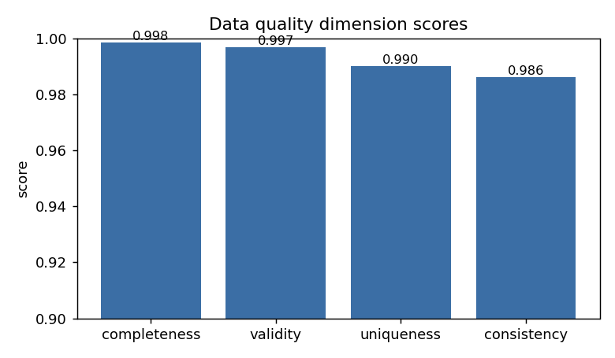
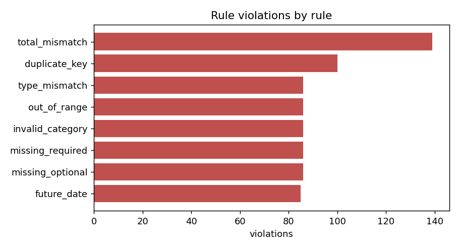

# AutoDataGuard: Example Report

> Generated by `python -m autodataguard run`. All numbers are computed from a **synthetic** dataset (seed 42) and do not represent any real company.

## 1. Dataset

- Raw rows: 10100 (including 100 exact duplicate rows removed before modelling)
- Modelling rows: 10000; injected anomalies: 200 (2.00%)

| split | rows | anomalies |
|---|---|---|
| train | 6000 | 120 |
| val | 2000 | 40 |
| test | 2000 | 40 |

## 2. Data quality validation

Overall score (mean of four dimensions): **0.9929**

| dimension | score |
|---|---|
| completeness | 0.9985 |
| validity | 0.9969 |
| uniqueness | 0.9901 |
| consistency | 0.9862 |

Violations by rule:

| rule | dimension | severity | violations | rows_affected |
|---|---|---|---|---|
| total_mismatch | consistency | error | 139 | 139 |
| duplicate_key | uniqueness | error | 100 | 100 |
| invalid_category | validity | error | 86 | 86 |
| missing_optional | completeness | warning | 86 | 86 |
| missing_required | completeness | error | 86 | 86 |
| out_of_range | validity | error | 86 | 86 |
| type_mismatch | validity | error | 86 | 86 |
| future_date | validity | error | 85 | 85 |

Rule engine versus injected ground truth (row level):

| dq_issue_type | n_injected | detected | recall |
|---|---|---|---|
| duplicate_key | 100 | 100 | 1.000 |
| future_date | 85 | 85 | 1.000 |
| invalid_category | 86 | 86 | 1.000 |
| missing_optional | 86 | 86 | 1.000 |
| missing_required | 86 | 86 | 1.000 |
| out_of_range | 86 | 86 | 1.000 |
| total_mismatch | 85 | 85 | 1.000 |
| type_error | 86 | 86 | 1.000 |

## 3. Anomaly detection

Detector selection criterion: validation PR-AUC. Selected: **robust_zscore_baseline**.

Test-split results (threshold = max F1 on validation):

| model | val PR-AUC | test PR-AUC | test ROC-AUC | precision | recall | F1 |
|---|---|---|---|---|---|---|
| robust_zscore_baseline | 0.946 | 0.938 | 0.999 | 0.909 | 0.750 | 0.822 |
| isolation_forest | 0.618 | 0.718 | 0.982 | 0.700 | 0.525 | 0.600 |
| local_outlier_factor | 0.694 | 0.754 | 0.981 | 0.821 | 0.575 | 0.676 |

Test-split results (threshold = lowest with validation FPR <= 0.01):

| model | threshold | precision | recall | FPR | false positives |
|---|---|---|---|---|---|
| robust_zscore_baseline | 3.1798 | 0.7500 | 0.9750 | 0.0066 | 13 |
| isolation_forest | 0.5693 | 0.6667 | 0.5500 | 0.0056 | 11 |
| local_outlier_factor | 1.3928 | 0.7105 | 0.6750 | 0.0056 | 11 |

### Recall by anomaly type

| anomaly_type | n_test | detected | recall |
|---|---|---|---|
| price_spike | 13 | 11 | 0.846 |
| bulk_quantity | 9 | 7 | 0.778 |
| extreme_discount | 8 | 2 | 0.250 |
| slow_shipping | 10 | 10 | 1.000 |

### False-positive analysis

3 of 1960 normal test rows were flagged (FPR 0.0015).

Highest-scoring false positives:

| row_index | score | top_driver | product_category | quantity | unit_price | discount_pct | shipping_days | customer_age | dq_issue_type |
|---|---|---|---|---|---|---|---|---|---|
| 6411 | 5.438 | log_price_ratio | Gadgets | 3 | 501.620 | 15 | 4 | 38 | invalid_category |
| 2424 | 4.447 | log_price_ratio | Gadgets | 1 | 9.740 | 5 | 5 | 22 | invalid_category |
| 6531 | 4.221 | log_price_ratio | clothing  | 2 | 308.720 | 0 | 5 | 48 | invalid_category |

## 4. Evidence-based insights

- The rule engine flagged 700 rows; 700 of 700 injected data-quality rows were caught (recall 1.000, precision 1.000).
- The selected detector (robust_zscore_baseline, chosen by validation PR-AUC) reached test PR-AUC 0.938 versus a prevalence baseline of 0.020 (46.9x lift) and test ROC-AUC 0.999.
- The simple robust z-score baseline was the best model on validation PR-AUC, so the more complex detectors did not add value on this dataset.
- At the validation-selected threshold the test split gives precision 0.909, recall 0.750, F1 0.822 (validation F1 was 0.925).
- Recall was highest for slow_shipping (1.00, n=10) and lowest for extreme_discount (0.25, n=8); per-type counts are small, so treat these as indicative.
- There were 3 false positives (FPR 0.0015); 100% of them were rows that also carried an injected data-quality issue, and the most common top-driver feature was log_price_ratio (3 rows).

## 5. Caveats

- Data and anomalies are synthetic and injected by simple rules; real-world performance will differ.
- The rule engine is evaluated against faults injected by rules of the same kind, so its perfect recall is expected and shows correct implementation, not real-world coverage.
- Anomaly types were designed by the author, so recall by type reflects that design.
- Test splits contain few anomalies; metrics carry sampling uncertainty (no confidence intervals computed).
- Labels were used for splitting, threshold selection and evaluation only, never as model inputs.
